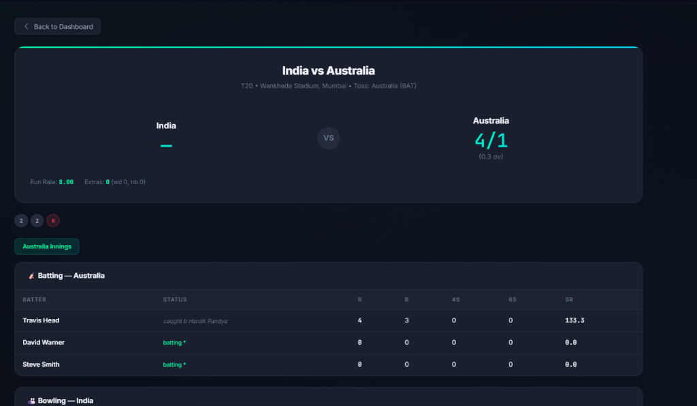
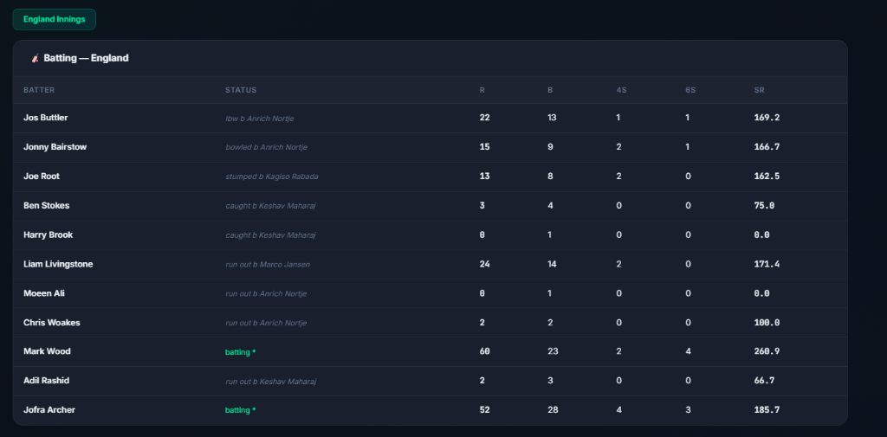
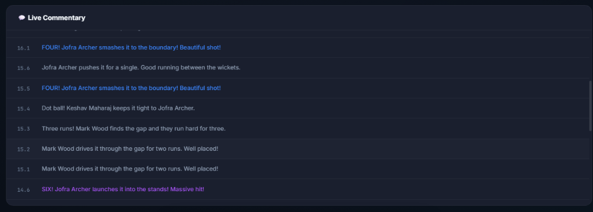

# 🏏 CricLive — Real-Time Cricket Score Management & Simulation Platform

A scalable, real-time cricket score management system built with **Spring Boot 3** (backend) and a modern **responsive web dashboard** (frontend). The system simulates live international cricket matches with ball-by-ball scoring, player statistics, active partnerships, live bowler telemetry, and commentary streamed over STOMP WebSockets.

---

## 📸 Screenshots

### 1. Live Match Center & Scoreboard


### 2. Live Batting Scorecard & Player Statistics


### 3. Real-Time Ball-by-Ball Commentary Stream


---

## 📁 Project Structure

The project is formatted into clean, isolated `frontend` and `backend` modules:

```
cricket-simulator/
│
├── 📂 backend/                                # Spring Boot 3 Java Backend
│   ├── src/main/java/com/cricket/
│   │   ├── controller/
│   │   │   └── MatchController.java           # REST API endpoints (CRUD, Simulation, Controls)
│   │   ├── service/
│   │   │   └── MatchService.java              # State management & background ball simulation
│   │   ├── model/
│   │   │   ├── Match.java                     # Match entity
│   │   │   ├── Innings.java                   # Innings, totals, FOW, extras
│   │   │   ├── Player.java                    # Batting & bowling statistics
│   │   │   └── BallEvent.java                 # Ball outcome model
│   │   ├── config/
│   │   │   ├── WebSocketConfig.java           # STOMP broker & message transport
│   │   │   └── WebConfig.java                 # Cross-Origin (CORS) configuration
│   │   └── CricketSimulatorApplication.java   # Main application class
│   ├── src/main/resources/
│   │   ├── application.properties             # Port 8080 configuration
│   │   └── static/                            # Built-in packaged web assets
│   ├── pom.xml                                # Maven build specifications
│   ├── mvnw.cmd                               # Maven wrapper
│   └── README.md                              # Backend docs & REST endpoints
│
├── 📂 frontend/                               # Dedicated Standalone Web Dashboard
│   ├── css/
│   │   └── styles.css                         # White Mode design system & responsive layout
│   ├── js/
│   │   ├── api.js                             # Auto-detecting REST & WebSocket STOMP client
│   │   └── app.js                             # Match center, tabs & UI controller
│   ├── index.html                             # Clean White Mode semantic dashboard
│   └── README.md                              # Frontend documentation
│
├── 📂 screenshots/                            # Application Screenshots
│   ├── live-scoreboard.png
│   ├── batting-scorecard.png
│   └── live-commentary.png
│
├── .gitignore
└── README.md                                  # Main project documentation
```

---

## ✨ Features

- **White Mode Design System** — Pristine, high-contrast light mode with an optional Dark Mode switch.
- **Top Match Ticker** — Continuous ticker showing all concurrent matches, scores, and status.
- **Hero Match Center** —
  - Big live scoreboard with team flags (🇮🇳, 🇦🇺, 🏴󠁧󠁢󠁥󠁮󠁧󠁿, 🇿🇦), venue, toss details, format, and status.
  - Run rate telemetry: Current Run Rate (CRR), Required Run Rate (RRR), Target, runs needed, and balls remaining.
- **Live Batter & Bowler Widgets** —
  - Striker (marked with `*`) and Non-striker with individual Runs, Balls, 4s, 6s, and Strike Rate.
  - Active bowler with Overs, Maidens, Runs, Wickets, and Economy.
  - This Over ball-by-ball circle tracker (`0`, `1`, `4`, `6`, `W`, `WD`).
  - Active partnership calculation.
- **Interactive Simulation Controls** —
  - `⚡ Next Ball`: Simulate 1 delivery immediately.
  - `⏩ Next Over`: Complete 1 full 6-ball over instantly.
  - `⏸️ Pause / ▶️ Resume`: Control auto-simulation pace.
  - `🔄 Reset`: Re-initialize demo matches.
- **Comprehensive Match Tabs** —
  - ⚡ **Live Center**: Hero match view, live commentary stream, quick simulation actions.
  - 📊 **Full Scorecard**: Both innings complete batting cards (status, runs, balls, 4s, 6s, SR), extras breakdown, total, yet to bat list, complete bowling cards, and **Fall of Wickets** (`1-24, 2-85...`).
  - 🎙️ **Ball-by-Ball Commentary**: Full timeline of all deliveries with outcome badges (FOUR, SIX, WICKET, DOT) and narrative commentary.
  - 👥 **Playing XI & Squads**: Full 11-player squads for both teams with role badges (Batsman, Bowler, All-Rounder, Wicket Keeper).
  - 📋 **Match Summary & Analysis**: Official match summary with toss, venue, umpires, winner, margin of victory, and Player of the Match.
  - 🏆 **Tournament Leaderboard**: Top run scorers (Orange Cap) & top wicket takers (Purple Cap) across all matches.
- **New Match Creator** — Configure custom matches on-the-fly.

---

## 📡 REST API Reference

| Method | Endpoint | Description |
|---|---|---|
| `GET` | `/api/matches` | Get all matches (live & completed) |
| `GET` | `/api/matches/live` | Get only currently active matches |
| `GET` | `/api/matches/completed` | Get all completed matches |
| `GET` | `/api/matches/{id}` | Get complete details for a single match |
| `GET` | `/api/matches/{id}/summary` | Get official match summary & top performers |
| `GET` | `/api/matches/{id}/players?team={name}` | Get player statistics for a team |
| `GET` | `/api/matches/leaderboard` | Get tournament leaderboard (Orange & Purple cap) |
| `POST` | `/api/matches` | Create a new match (`team1`, `team2`, `matchType`, `venue`) |
| `POST` | `/api/matches/{id}/ball` | Trigger a single ball delivery immediately |
| `POST` | `/api/matches/{id}/over` | Simulate 1 full over (6 legal balls) immediately |
| `POST` | `/api/matches/{id}/toggle-pause` | Pause or resume live match auto-simulation |
| `POST` | `/api/matches/reset` | Reset all demo matches to fresh state |
| `DELETE` | `/api/matches/{id}` | Delete a match |

---

## 🚀 Running the Project

### 1. Start the Backend
Open a terminal in the `backend/` folder (or project root):
```powershell
cd backend
.\mvnw.cmd spring-boot:run
```
The backend starts on `http://localhost:8080`.

### 2. View the Frontend
You can view the frontend in either of two ways:
1. **Via Spring Boot Server**: Open [http://localhost:8080](http://localhost:8080) in your web browser.
2. **As Standalone Frontend**: Open `frontend/index.html` directly in any browser or with Live Server (the `frontend/js/api.js` automatically connects to `http://localhost:8080` via CORS).
